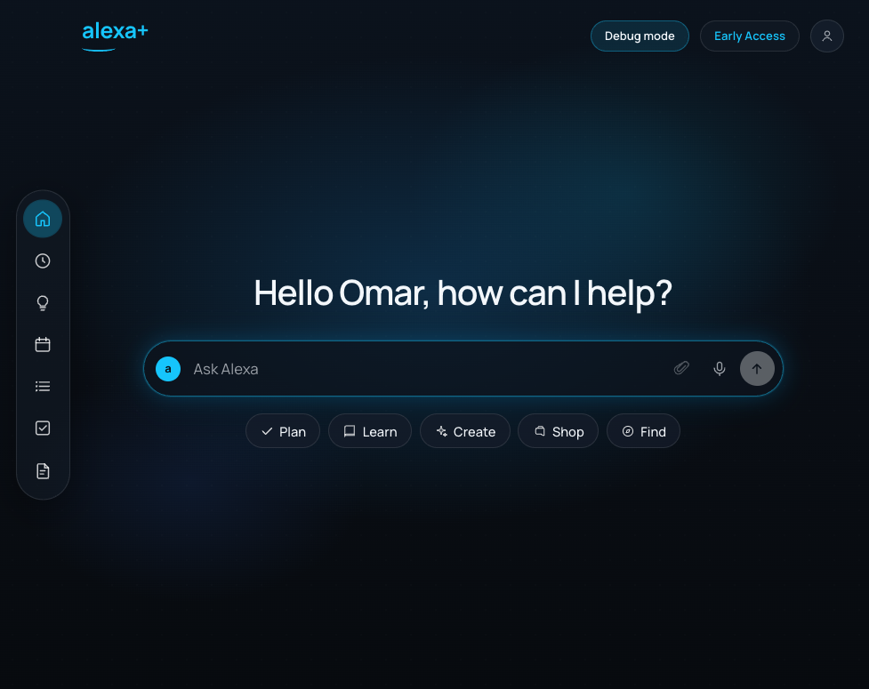
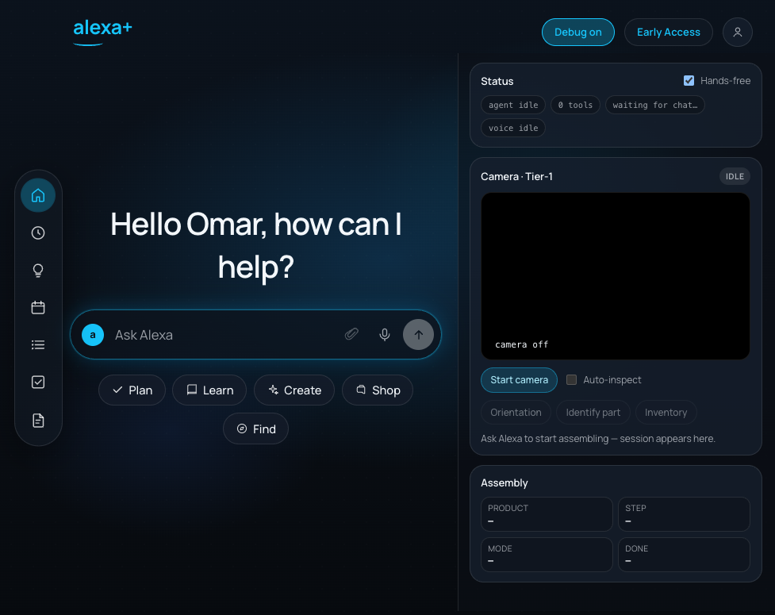
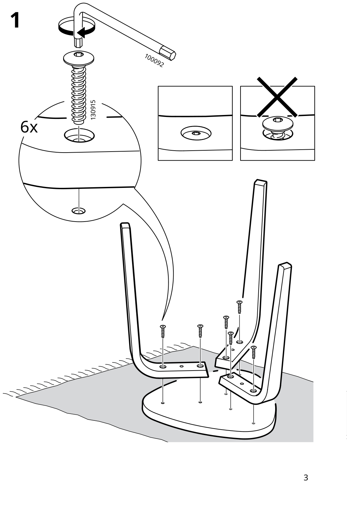
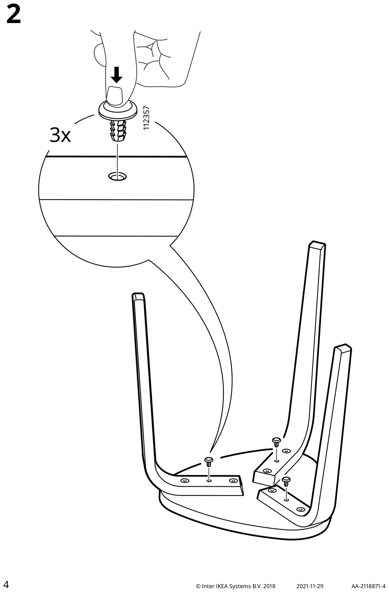
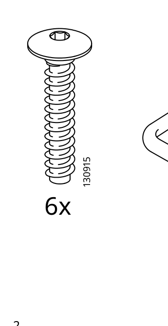
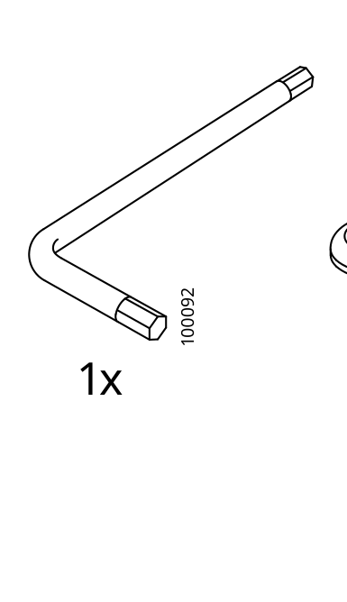
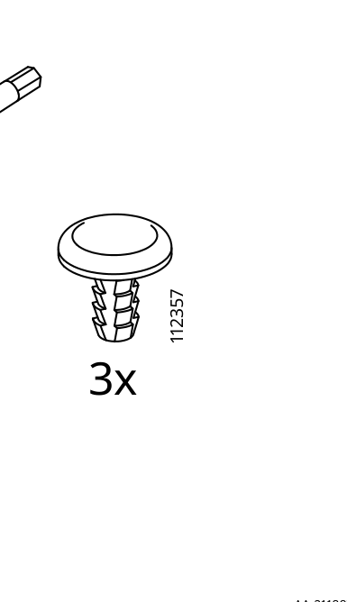

# Amazon Alexa+ Ikea Furniture MCP Integration

Autonomous assembly assistant for the **Amazon Alexa+ Developer Hackathon**. Helps people assemble IKEA furniture (demo product: **KYRRE**) with:

- Voice-style Alexa+ chat UI (hands-free mic + TTS)
- Camera vision (orientation, part ID, inventory)
- Agentic MCP host (Cohere picks tools; same tools as Streamable HTTP MCP)
- Simulated IKEA spare-parts ordering + Taskrabbit Tasker booking

MCP protocol target: **Streamable HTTP, spec `2025-11-25`**.

---

## Screenshots

### Alexa+ demo home



### Debug mode (camera + assembly context + MCP wire)



### KYRRE step diagrams (ground truth)

| Step 1 — attach legs | Step 2 — push plugs |
| --- | --- |
|  |  |

### Parts library (BOM reference photos)

| `#130915` hex socket screw | `#100092` allen key | `#112357` plastic push plug |
| --- | --- | --- |
|  |  |  |

---

## Architecture

Business logic lives behind **stable interfaces** in a shared core. FastAPI and MCP are thin adapters over the same code.

```
core/               ← domain models + interfaces + services
adapters/http       ← FastAPI (/v1, Alexa+ UI, sim agent, TTS)
adapters/mcp        ← Streamable HTTP MCP (/mcp) — same tools
infra/              ← Cohere, ElevenLabs, GroundingDINO, IKEA APO, parts
data/<product>/     ← ground truth (manifest, diagrams, parts)
web/                ← Vite + React Alexa+ demo UI → web/dist
```

```
User (voice / text / camera)
        │
        ▼
  web/ (Alexa+ UI)  ──SSE──►  POST /v1/sim/agent
        │                           │
        │                           ▼
        │                    Cohere agent (tools)
        │                           │
        │                           ▼
        │                    MCPServer.call_tool  ◄── same as /mcp
        │                           │
        └───────────────────────────┼──────────────────────────┐
                                    ▼                          ▼
                         core services (catalog,          ElevenLabs TTS
                         session, vision, ordering,       POST /v1/sim/tts
                         ingest)
```

Alexa+ / the agent **never scrapes ikea.com**. It calls `ingest_product`; our backend searches IKEA, downloads the PDF, slices diagrams, and optionally enriches with Cohere Vision.

---

## Quick start

```bash
cd amazon-alexa-hackathon
cp .env.example .env
# Edit .env — set COHERE_API_KEY (required for agent + vision)
# Optional: ELEVENLABS_API_KEY for spoken replies

./scripts/build.sh
```

| Surface | URL |
| --- | --- |
| Alexa+ demo UI | http://127.0.0.1:8000/ |
| Debug mode (camera + MCP cards) | http://127.0.0.1:8000/?debug=1 |
| Health | http://127.0.0.1:8000/health |
| OpenAPI / Swagger | http://127.0.0.1:8000/docs |
| MCP (Streamable HTTP) | http://127.0.0.1:8000/mcp |

`/sim` and `/assembly` redirect to `/?debug=1`.

Live UI reload (API still on `:8000`):

```bash
cd web && npm run dev   # http://127.0.0.1:5173
```

---

## Environment variables

From [`.env.example`](.env.example):

| Variable | Purpose |
| --- | --- |
| `COHERE_API_KEY` / `CO_API_KEY` | Cohere Chat v2 (agent + vision + enrich) |
| `COHERE_VISION_MODEL` | Image inspect / enrich — default `command-a-vision-07-2025` |
| `COHERE_ENRICH_MODEL` | Alias for vision during ingest enrich |
| `COHERE_TEXT_MODEL` | Agent tool-calling — default `command-a-plus-05-2026` |
| `ELEVENLABS_API_KEY` | Spoken TTS in the demo UI |
| `ELEVENLABS_VOICE_ID` | Optional override (default Sarah `EXAVITQu4vr4xnSDxMaL`) |
| `ELEVENLABS_MODEL_ID` | Optional override (default `eleven_flash_v2_5`) |

**Important:** vision/image paths use **Command A Vision**. The agent (text + tools) uses **Command A+**. Do not point `COHERE_VISION_MODEL` at a text-only model.

---

## Integrations & libraries (everything we use)

### Cohere

| Piece | Model / API | Used for |
| --- | --- | --- |
| Vision inspect | `command-a-vision-07-2025` via `POST https://api.cohere.ai/v2/chat` | Orientation (webcam ↔ diagram), inventory piece list, part-crop compare, ingest enrich |
| Agent host | `command-a-plus-05-2026` | Tool selection + short spoken replies (`src/infra/cohere_agent.py`) |
| Client | `src/infra/cohere_client.py` | `chat_json` (vision + JSON), `chat_text_json`, `png_data_url` |

Images are sent as `image_url` blocks with `data:image/png;base64,...` and `detail=high` where needed.

### ElevenLabs

| Piece | Detail |
| --- | --- |
| API | `POST https://api.elevenlabs.io/v1/text-to-speech/{voice_id}` |
| Wrapper | `src/infra/elevenlabs_tts.py` |
| Default voice | Sarah (`EXAVITQu4vr4xnSDxMaL`) |
| Default model | `eleven_flash_v2_5` (cheap/fast) |
| Output | `mp3_22050_32` |
| HTTP | `POST /v1/sim/tts`, status `GET /v1/sim/tts/status` |

### GroundingDINO (part ID)

| Piece | Detail |
| --- | --- |
| Package | `groundingdino-py` + PyTorch / torchvision / transformers `<4.41` |
| Wrapper | `src/infra/grounding_dino_parts.py` |
| Weights | Swin-T OGC downloaded to `weights/` at runtime (gitignored) |
| Role | Open-vocab boxes for `inspect_part` (singular prompts only) |
| Not used for | Inventory counts (Cohere piece-list) or orientation (Cohere A↔B only) |

### IKEA

| Piece | Detail |
| --- | --- |
| Manual ingest | Search → PDF download → PyMuPDF page → diagram PNGs (`src/core/services/ingest.py`) |
| APO lookup | Optional spare-part enrich (`src/infra/ikea_apo.py`) — often Cloudflare-gated; mock order still works |
| Parts library | BOM line drawings under `data/<product>/parts/{partId}.png` |

### Taskrabbit (simulated)

Mock booking only — `book_taskrabbit_help` / `POST …/orders/taskrabbit`. No real Taskrabbit API key, no email/payment collected.

### Frontend / voice I/O

| Piece | Detail |
| --- | --- |
| UI | Vite + React + TypeScript (`web/`) |
| Mic | Browser `SpeechRecognition` (Chrome/Edge) |
| Agent stream | SSE from `POST /v1/sim/agent` |
| Frame attach | Host captures webcam when a vision tool is called; agent omits `frame_base64` |

### MCP

| Piece | Detail |
| --- | --- |
| Spec | Streamable HTTP, minimum acceptable version **`2025-11-25`** |
| Server | Python `mcp` package (`MCPServer`), mounted at `/mcp` |
| Agent path | Same `MCPServer.call_tool` used by the sim host (no duplicate tool logic) |
| Smoke | `PYTHONPATH=src python scripts/smoke_mcp.py` |

### Other Python deps

FastAPI, Uvicorn, Pydantic v2, httpx, python-dotenv, Pillow, PyMuPDF, Typer, Ultralytics (legacy YOLO helper), OpenCV headless.

---

## MCP tools (complete catalog)

All tools are registered in `src/adapters/mcp/server.py` and mirrored by FastAPI where noted. The Alexa+ agent sees this same list.

### 1. Catalog & product knowledge

| Tool | What it does | How it works |
| --- | --- | --- |
| **`list_products`** | Lists local ground-truth packages under `data/`. | Reads filesystem catalog → `ProductSummary[]`. |
| **`get_product`** | Full manifest (display name, steps, BOM summary). | Loads `data/<id>/manifest.json`. |
| **`list_bom`** | Bill of materials with `partId`, `name`, `qty`. | From manifest `bom[]`. |
| **`list_assembly_steps`** | Step metadata only (no diagram bytes). | From manifest `steps[]`. |
| **`get_assembly_step`** | One step + required hardware + completion hints + `diagramUrl`. | Loads step; UI fetches diagram separately. |
| **`get_part_image`** | Reference photo for a `partId`. | Serves `data/<product>/parts/{partId}.png` as `imageBase64` + URL. |

### 2. Ingest (IKEA → local package)

| Tool | What it does | How it works |
| --- | --- | --- |
| **`ingest_product`** | Find / download / slice an IKEA manual into a local package. | Call **only** after the user names a product (e.g. `query="KYRRE"`). Backend owns IKEA HTTP + PDF. `enrich=true` runs Cohere Vision over diagrams to fill names/titles/hints. Returns `alreadyExists` if package present (unless `force=true`). |

HTTP twin: `POST /v1/products/ingest`.

### 3. Assembly sessions

| Tool | What it does | How it works |
| --- | --- | --- |
| **`create_session`** | Start or **reuse** a session for a `productId`. | Pass catalog id (`kyrre`), never invent a UUID. Returns `sessionId` + `AssemblyState` + `reused`. |
| **`get_session`** | Current state (step, mode, completed flags). | Pass the UUID from `create_session`. |
| **`advance_session`** | Move to the next step. | Increments `currentStep` when valid. |

HTTP twins: `POST /v1/sessions`, `GET|PATCH /v1/sessions/{id}`, `POST …/advance`.

### 4. Vision inspect

| Tool | What it does | How it works |
| --- | --- | --- |
| **`inspect_orientation`** | Does the webcam match the step diagram? | Cohere Vision only: Image A = webcam, Image B = official diagram. Returns `aligned`, `stepCompleted`, `diagramObserved`, `webcamObserved`. **No bounding boxes / no DINO.** Tightness is not judged from photos. |
| **`inspect_part`** | Which fastener is in frame for this step? | GroundingDINO open-vocab detect (`detect_prompt` **singular** classes only) → crop each box → Cohere compare to `parts/{partId}.png` → highest similarity wins. Debug trail + optional annotated frame. |
| **`inspect_inventory`** | Count kit parts vs BOM. | Cohere-only piece list: scene gate (reject faces/empty desks) → `pieces[{partId,where}]` → `seenQty = len(accepted rows)`. Never places an order. |

HTTP twins: `POST …/inspect/orientation|part|inventory` with `frameBase64`.

**Vision rules the agent follows**

- Call vision tools only when the user is clearly showing something on camera.
- Host attaches the live webcam frame; agent omits `frame_base64`.
- Orientation: trust `aligned` / `stepCompleted`; no “tighten more” inventions.
- Inventory: trust `counted[]` / `missing[]`; don’t invent kit totals.

### 5. Commerce & help (simulated)

| Tool | What it does | How it works |
| --- | --- | --- |
| **`order_replacement_parts`** | Mock IKEA spare-parts order. | Pass `items[{partId,name,qty}]` from inventory `missing[]`. Names filled from BOM if blank. **No email / payment.** Returns `orderId`, line items with name + `#partId`, ETA, `checkoutUrl`. |
| **`book_taskrabbit_help`** | Mock Taskrabbit Tasker booking. | For “send someone / Taskrabbit / I can’t finish.” Optional `notes`, `urgency` (`today`\|`asap`\|`schedule`). **No email / payment.** Returns `bookingId`, tasker, arrival window, total, `checkoutUrl`. |

HTTP twins: `POST …/orders/replacement-parts`, `POST …/orders/taskrabbit`.

---

## HTTP API surface (complete)

Full OpenAPI: http://127.0.0.1:8000/docs — also [docs/API.md](docs/API.md).

### Catalog

| Method | Path |
| --- | --- |
| `GET` | `/v1/products` |
| `GET` | `/v1/products/{product_id}` |
| `GET` | `/v1/products/{product_id}/bom` |
| `GET` | `/v1/products/{product_id}/bom/diagram` |
| `GET` | `/v1/products/{product_id}/parts` |
| `GET` | `/v1/products/{product_id}/parts/{part_id}` |
| `GET` | `/v1/products/{product_id}/steps` |
| `GET` | `/v1/products/{product_id}/steps/{step_number}` |
| `GET` | `/v1/products/{product_id}/steps/{step_number}/diagram` |
| `POST` | `/v1/products/ingest` |

### Sessions & vision & orders

| Method | Path |
| --- | --- |
| `POST` | `/v1/sessions` |
| `GET` / `PATCH` | `/v1/sessions/{session_id}` |
| `POST` | `/v1/sessions/{session_id}/advance` |
| `POST` | `/v1/sessions/{session_id}/inspect/orientation` |
| `POST` | `/v1/sessions/{session_id}/inspect/part` |
| `POST` | `/v1/sessions/{session_id}/inspect/inventory` |
| `POST` | `/v1/sessions/{session_id}/orders/replacement-parts` |
| `POST` | `/v1/sessions/{session_id}/orders/taskrabbit` |

### Alexa+ sim host

| Method | Path | Role |
| --- | --- | --- |
| `POST` | `/v1/sim/greeting` | Fixed wake line (“Hi. How can I help?”) |
| `POST` | `/v1/sim/agent` | Agentic MCP host (SSE: tools, speak, debug_step, need_frame) |
| `POST` | `/v1/sim/agent/frame` | Deliver webcam frame when a vision tool needs it |
| `POST` | `/v1/sim/interpret` | Lightweight intent classifier (legacy / helpers) |
| `POST` | `/v1/sim/narrate` | Short spoken narration of an event |
| `POST` | `/v1/sim/tts` | ElevenLabs MP3 |
| `GET` | `/v1/sim/tts/status` | Whether ElevenLabs is configured |

### Meta / UI

| Method | Path |
| --- | --- |
| `GET` | `/health` |
| `GET` | `/` | Serves `web/dist` Alexa+ UI |
| `GET` | `/sim`, `/assembly` | Redirect → `/?debug=1` |
| mount | `/mcp` | Streamable HTTP MCP |

---

## Demo product: KYRRE

On-disk package: `data/kyrre/`

| Field | Value |
| --- | --- |
| `productId` | `kyrre` |
| BOM | `#130915` hex socket screw ×6, `#100092` allen key ×1, `#112357` plastic push plug ×3 |
| Step 1 | Attach the legs to the seat (6 screws + allen key) |
| Step 2 | Push in the three plastic plugs |

Manifest: [`data/kyrre/manifest.json`](data/kyrre/manifest.json).

---

## Agent behavior (short)

System prompt: `src/adapters/http/mcp_agent.py` (`AGENT_SYSTEM`).

- Alexa+ persona; **1–2 short spoken sentences** (~35 words).
- Never invent a product; ask which piece if unnamed.
- Kickoff: after ingest + session → `list_bom` → offer parts check **or** jump to step 1; wait.
- Vision only when showing camera content.
- Orders / Taskrabbit: confirm once, then mock checkout — **never ask for email**.
- Speak part **name + number** on IKEA orders (e.g. hex socket screw `#130915`).

Journey chips in the UI (Plan / Learn / Create / Shop / Find) seed example prompts.

---

## Scripts

| Script | Purpose |
| --- | --- |
| `./scripts/build.sh` | venv + pip + `web` production build + uvicorn `--reload` on `:8000` |
| `scripts/smoke_mcp.py` | MCP initialize / tools / sample calls |
| `scripts/smoke_inspect.py` | Cohere orientation smoke against diagram |
| `scripts/prepare_manual.py` | Re-slice a local PDF into `data/<id>/` |

---

## Repo map

```
src/core/models|interfaces|services   domain
src/adapters/http                     FastAPI + mcp_agent + sim routes
src/adapters/mcp                      Streamable HTTP MCP tools
src/infra                             Cohere, ElevenLabs, DINO, APO, parts
web/                                  Alexa+ React UI
data/kyrre/                           demo ground truth
docs/                                 PRODUCT, ARCHITECTURE, API, ROADMAP, screenshots
.cursor/skills/apple-design/          Apple HIG design-review skill for the UI
```

---

## Extra docs

| Doc | Purpose |
| --- | --- |
| [docs/PRODUCT.md](docs/PRODUCT.md) | Product definition & user journeys |
| [docs/ARCHITECTURE.md](docs/ARCHITECTURE.md) | Layered design |
| [docs/DATA.md](docs/DATA.md) | On-disk ground truth vs HTTP/MCP |
| [docs/API.md](docs/API.md) | Endpoint details |
| [docs/ROADMAP.md](docs/ROADMAP.md) | Phases |

---

## Status

Hackathon-ready demo path:

1. `./scripts/build.sh`
2. Open http://127.0.0.1:8000/?debug=1
3. Say / type you want to build **KYRRE** → parts check → steps → camera inspect → optional spare-parts or Taskrabbit mocks

For Alexa+ console: tunnel HTTPS to `/mcp` (e.g. ngrok) and register the Streamable HTTP URL with protocol version **`2025-11-25`**.
